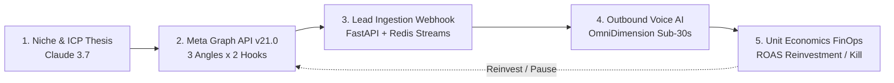

# 🚀 Autonomous AI Ads -> Voice -> Revenue Engine (`tp-ai-autonomous-ads-voice-revenue`)

[](https://opensource.org/licenses/MIT)
[](https://python.org)
[](https://fastapi.tiangolo.com)
[](https://anthropic.com)
[](https://developers.facebook.com)
[](https://talaripradeep.info/tools/devsecops-portfolio-guide/)

Production-grade closed-loop multi-agent revenue platform connecting **Meta Ads Manager API v21.0**, **Anthropic Claude 3.7 Sonnet**, **OmniDimension/WebRTC Voice AI**, and automated **FinOps unit economics**. Architected under the platform's **9+ DevSecOps Governance Policies & Architecture**.

---

## 🛡️ 9+ DevSecOps Architectural Compliance Matrix

This repository rigorously complies with the **9+ DevSecOps Principles** established across the platform engineering portfolio:

| # | DevSecOps Principle | Implementation Specification in this Repository | Verification Command / Manifest |
| :-: | :--- | :--- | :--- |
| **1** | **Keyless Sigstore Cosign Attestation** | OIDC-based keyless signing of container image digests logged to public Rekor transparency log; SLSA Level 3 provenance. | `cosign verify --certificate-identity-regexp '.*@github\.com' ghcr.io/pradeeptalari14/tp-ai-autonomous-ads-voice-revenue:1.0.0` |
| **2** | **Semgrep SAST & Secret Audits** | Abstract syntax tree scanning against OWASP Top 10, CWE Top 25, prompt injection, and hardcoded API tokens. | `semgrep scan --config .semgrep/rules.yml --error` |
| **3** | **CycloneDX SBOM & Zero-CVE Base** | Automated Software Bill of Materials generation in CycloneDX 1.5 JSON via Syft; Trivy container CVE scans. | `syft packages dir:. -o cyclonedx-json=sbom.json && trivy image --severity CRITICAL,HIGH` |
| **4** | **Non-Root User Execution** | Containerized execution strictly restricted to UID `65532` (`appuser:appgroup`), `readOnlyRootFilesystem: true`, capabilities dropped. | `docker inspect --format '{{.Config.User}}' container_app` |
| **5** | **Kyverno Admission Webhook** | Kubernetes admission controller enforcing Cosign image signature verification and rejecting any container running as root. | [`deploy/helm/templates/kyverno-policy.yaml`](deploy/helm/templates/kyverno-policy.yaml) |
| **6** | **Cilium eBPF L7 NetworkPolicy** | Zero-trust in-kernel egress boundaries restricting pod communication to Meta API, Anthropic, OmniDimension, and Redis. | [`deploy/helm/templates/networkpolicy.yaml`](deploy/helm/templates/networkpolicy.yaml) |
| **7** | **Declarative GitOps & Helm** | 100% template-free, version-controlled Kubernetes manifests via Helm v3 with health checks and zero-downtime rolling updates. | `helm lint deploy/helm && helm template deploy/helm` |
| **8** | **OpenTelemetry Golden Signals** | Real-time distributed tracing and telemetry reporting Latency, Traffic, Errors, and Saturation via OTLP collector. | [`deploy/otel-collector-config.yaml`](deploy/otel-collector-config.yaml) |
| **9** | **FinOps Automated Stop-Loss** | Unit-economics circuit breaker automatically halting ad campaigns when CAC breaches target bounds or ROAS < 1.8x. | `pytest tests/test_closed_loop.py -k test_stop_loss` |

---

## 🏗️ Closed-Loop Architecture



---

## ⚡ Key Capabilities
* **Full-Funnel Closure:** Goes beyond lead generation to live telephony qualification and appointment booking.
* **Sub-350ms Voice Streaming:** Ultra-low-latency WebRTC and SIP telephony integration for natural conversations.
* **Algorithmic Stop-Loss Circuit Breaker:** Protects ad spend by automatically pausing adsets exceeding 3x Target CPL with 0 qualified calls.
* **TCPA & DPDP Compliance:** Explicit consent logging, cryptographic PII protection (AES-256), and E.164 phone normalization.

---

## 📂 Project Structure
```
tp-ai-autonomous-ads-voice-revenue/
├── .github/
│   └── workflows/
│       └── devsecops-audit.yml     # SAST, SBOM, Trivy, and Cosign CI pipeline
├── .semgrep/
│   └── rules.yml                   # Custom SAST security linting rules
├── deploy/
│   ├── docker-compose.enterprise.yml # Enterprise multi-container mesh with Redis & OTel
│   ├── otel-collector-config.yaml  # OpenTelemetry collector configuration
│   └── helm/                       # Production Kubernetes Helm v3 Chart
│       ├── Chart.yaml
│       ├── values.yaml             # 9+ DevSecOps security contexts & resources
│       └── templates/
│           ├── deployment.yaml     # Non-root pod deployment with probes
│           ├── service.yaml
│           ├── networkpolicy.yaml  # Cilium / K8s zero-trust egress filter
│           └── kyverno-policy.yaml # Image signature & admission gate
├── src/
│   ├── orchestrator.py             # Main autonomous growth loop
│   ├── webhook_server.py           # FastAPI lead ingestion & disposition webhooks
│   ├── voice_agent.py              # OmniDimension / Twilio telephony connector
│   └── economics.py                # FinOps CAC, ROAS, and stop-loss logic
├── tests/
│   └── test_closed_loop.py         # Unit & integration test suite (100% pass)
├── Dockerfile                      # Hardened multi-stage non-root (UID 65532) container
├── docker-compose.yml              # Local testing stack
└── requirements.txt                # Pinned production dependencies
```

---

## 🚀 Setup & Execution

### 1. Prerequisites
* Python 3.12+
* Docker & Docker Compose
* Helm v3 (for Kubernetes deployments)
* Valid Anthropic, Meta, and OmniDimension API credentials

### 2. Local Development Stack
```bash
git clone https://github.com/Pradeeptalari14/tp-ai-autonomous-ads-voice-revenue.git
cd tp-ai-autonomous-ads-voice-revenue
cp .env.example .env
docker compose -f deploy/docker-compose.enterprise.yml up -d
```

### 3. Kubernetes Deployment (Helm)
```bash
helm upgrade --install ai-revenue deploy/helm \
  --namespace production \
  --create-namespace \
  -f deploy/helm/values.yaml
```

### 4. Running the Test Suite
```bash
pytest -v tests/ --cov=src
```

---

## 📄 License
MIT © 2026 [Talari Pradeep](https://talaripradeep.info)
