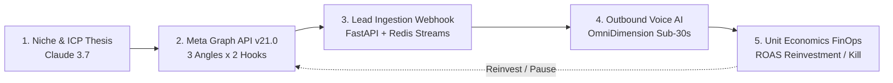

# 🚀 Autonomous AI Ads -> Voice -> Revenue Engine (`tp-ai-autonomous-ads-voice-revenue`)

[](https://opensource.org/licenses/MIT)
[](https://python.org)
[](https://fastapi.tiangolo.com)
[](https://anthropic.com)
[](https://developers.facebook.com)

Production-grade closed-loop multi-agent revenue platform connecting **Meta Ads Manager API v21.0**, **Anthropic Claude 3.7 Sonnet**, **OmniDimension/WebRTC Voice AI**, and automated **FinOps unit economics**.

---

## 🏗️ Architecture



---

## ⚡ Key Capabilities
* **Full-Funnel Closure:** Goes beyond lead generation to live telephony qualification and appointment booking.
* **Sub-350ms Voice Streaming:** Ultra-low-latency WebRTC and SIP telephony integration for natural conversations.
* **Algorithmic Stop-Loss Circuit Breaker:** Protects ad spend by automatically pausing adsets exceeding 3x Target CPL with 0 qualified calls.
* **TCPA & DPDP Compliance:** Explicit consent logging, cryptographic PII protection, and E.164 phone normalization.

---

## 📂 Project Structure
```
tp-ai-autonomous-ads-voice-revenue/
├── src/
│   ├── orchestrator.py      # Main autonomous growth loop
│   ├── webhook_server.py    # FastAPI lead ingestion & disposition webhooks
│   ├── voice_agent.py       # OmniDimension / Twilio telephony connector
│   └── economics.py         # FinOps CAC, ROAS, and stop-loss logic
├── tests/
│   └── test_closed_loop.py  # Unit & integration test suite
├── docker-compose.yml       # Production container mesh
└── requirements.txt         # Pinned production dependencies
```

---

## 🚀 Setup & Execution

### 1. Prerequisites
* Python 3.12+
* Redis 7+
* Valid Anthropic, Meta, and OmniDimension API credentials

### 2. Installation
```bash
git clone https://github.com/Pradeeptalari14/tp-ai-autonomous-ads-voice-revenue.git
cd tp-ai-autonomous-ads-voice-revenue
pip install -r requirements.txt
```

### 3. Environment Configuration
Create a `.env` file:
```env
ANTHROPIC_API_KEY=sk-ant-...
META_ACCESS_TOKEN=EAAG...
META_AD_ACCOUNT_ID=act_1234567890
OMNIDIMENSION_API_KEY=omni_sec_...
REDIS_URL=redis://localhost:6379/0
DAILY_BUDGET_CAP=150
TARGET_CPL=18.5
STOP_LOSS_ROAS=1.8
```

### 4. Run the Engine
```bash
# Start FastAPI Webhook Server
uvicorn src.webhook_server:app --host 0.0.0.0 --port 8000

# Run Closed-Loop Test Simulation
python src/orchestrator.py
```

---

## 📄 License
MIT License &copy; 2026 Talari Pradeep.
